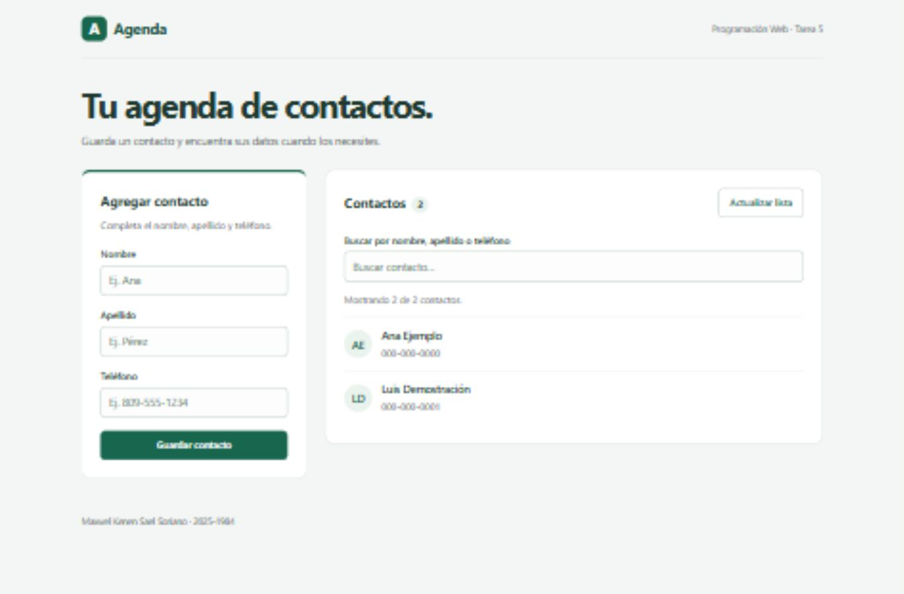
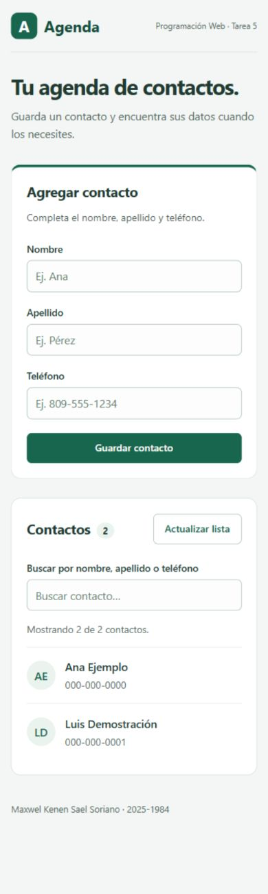

# Agenda Express

Servicio web de la Tarea 5 que permite listar y guardar contactos con Node.js y Express. Incluye una página para agregar contactos, actualizar la lista y buscar por nombre, apellido o teléfono.

## Estudiante

- **Nombre:** Maxwel Kenen Sael Soriano
- **Matrícula:** 2025-1984
- **Institución:** Instituto Tecnológico de Las Américas (ITLA)
- **Carrera:** Desarrollo de Software
- **Asignatura:** Programación Web
- **Tarea:** 5 — Servicio Web

## Ejecución

Requiere Node.js 22 o posterior y npm. Desde la carpeta del proyecto:

```bash
npm ci
npm start
```

Abrir [http://localhost:3000](http://localhost:3000). Para reiniciar el servidor automáticamente al modificar código, usar `npm run dev`. El puerto se puede cambiar con la variable de entorno `PORT`.

## Servicio

| Método y ruta | Funcionamiento |
| --- | --- |
| `GET /contactos` | Devuelve un arreglo JSON con los contactos. Si todavía no hay datos, devuelve `[]`. |
| `POST /contactos` | Guarda un contacto y devuelve sus tres campos con estado HTTP 201. |

Ejemplo del cuerpo de un POST, con encabezado `Content-Type: application/json`:

```json
{
  "nombre": "Ana",
  "apellido": "Ejemplo",
  "telefono": "000-000-0000"
}
```

Los tres campos son textos obligatorios. Se quitan los espacios al principio y al final; nombre y apellido admiten hasta 100 caracteres cada uno, y teléfono hasta 30. El teléfono se conserva como texto para mantener ceros, guiones o el signo `+`. Los campos adicionales no se guardan.

Las respuestas de error contienen una propiedad `error`: 400 para datos inválidos, 413 cuando el cuerpo supera 10 KB, 415 cuando el POST no se envía como JSON, 404 para rutas no disponibles y 500 cuando falla el acceso a los datos.

## Almacenamiento

El primer guardado crea `data/contactos.json`. Los contactos permanecen después de reiniciar el servidor. El archivo de datos se excluye de Git; una copia nueva del repositorio comienza con la agenda vacía.

Las escrituras se procesan en orden y cada guardado escribe primero un archivo temporal antes de reemplazar el archivo principal. Si los datos están dañados, el servicio devuelve un error y conserva el archivo para poder corregirlo.

La consigna pide listar y almacenar contactos con Express. El archivo JSON y la página de uso son decisiones de esta implementación. El servicio trabaja con sus propios datos; no envía contactos al servicio del profesor ni modifica las entregas anteriores.

Este almacenamiento está pensado para ejecutar una instancia del servidor sobre una carpeta con permiso de escritura. No incluye autenticación, edición ni eliminación. Para publicarlo como servicio se necesita un alojamiento que ejecute Node.js y conserve el archivo de datos; GitHub Pages solo sirve archivos estáticos.

## Organización

```text
index.html                 Página principal
css/styles.css             Estilos y adaptación móvil
js/agenda.js               Formulario, búsqueda y consultas desde el navegador
js/app.js                  Configuración de Express y respuestas de error
js/server.js               Inicio del servidor
js/routes/contactos.js     Rutas GET y POST con validación
js/services/contactos.js   Lectura y guardado del archivo JSON
test/contactos.test.js     Pruebas del servicio
img/                       Capturas de la aplicación
```

Solo se sirven la página, la hoja de estilos y el JavaScript del navegador. El código del servidor y el archivo JSON no se publican como archivos descargables.

## Comprobaciones

```bash
npm run check
npm test
```

La comprobación de sintaxis y las nueve pruebas del servicio pasaron. Las pruebas usan servidores locales y carpetas temporales: comprueban la lista vacía, el guardado, la persistencia al reiniciar, las validaciones, los errores de JSON y tamaño, doce envíos simultáneos, archivos dañados, fallos de escritura y las rutas públicas y privadas.

En el navegador se comprobó el formulario, el guardado con teclado, la búsqueda sin distinguir mayúsculas, el estado sin coincidencias, la recarga de los datos, los errores de conexión y la recuperación al reiniciar el servidor. Se revisó la interfaz en escritorio y en anchos móviles de 390 y 320 píxeles. Las capturas muestran contactos ficticios guardados en el servicio local.

## Capturas

### Escritorio



### Móvil


